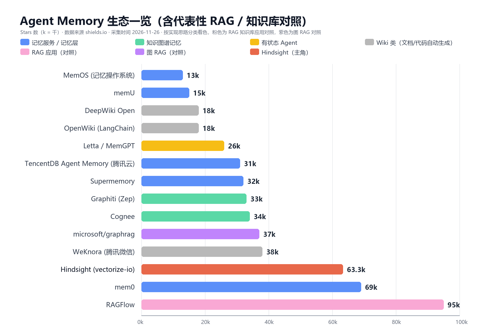
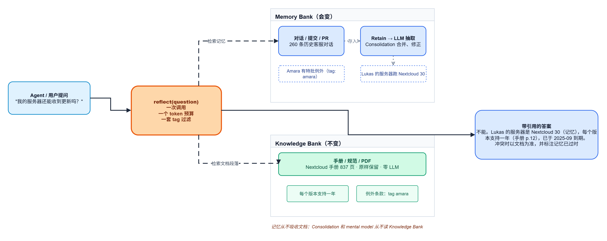
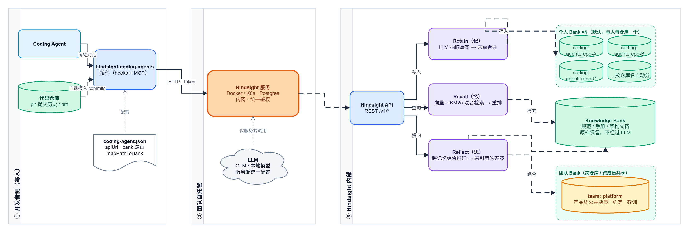

# 从个人工具到团队记忆：知识库搭建复盘与 Hindsight 实践

> 团队分享 · 2026-11-26
> 数据采集时间：2026-11-26 00:20（GitHub Stars 来自 shields.io，Hindsight 数据来自官方文档/博客/论文）

---

## 0. 一句话总结

> **代码能告诉 Agent "是什么"，但告诉不了它 "为什么"。**
> 过去一年我试了 Code Graph、RAG 知识库、Deep Wiki 等几类工具，最后落到 Hindsight 上——它解决的不是"把文档塞给 AI"，而是**把团队做过的决定、踩过的坑、达成过的共识，在 Agent 开工之前放到它面前**。
>
> 而且它没有抛弃知识库：**Memory Bank 管"现在什么成立"，Knowledge Bank 管"原文写了什么"，两者链接、一次查询、冲突时文档为准。** 这就是我理解的"知识库 + Agent Memory"的正确融合方式。

---

## 1. 我用过哪些知识库 / 记忆工具

### 1.1 Code Graph（代码图谱）

**原理**：用 tree-sitter 解析代码，把函数、类、调用关系、引用关系写进图数据库（Neo4j / Kuzu 等），Agent 通过 MCP 查询"谁调用了这个函数""这个变量在哪被改"。

代表项目：[CodeGraphContext](https://github.com/CodeGraphContext/CodeGraphContext)（体量不大，但思路典型）

**解决什么**：让 Agent 不用把整个仓库塞进上下文，就能精确拿到**代码结构层面**的上下文。对大仓库的"找入口 / 找影响面"很有效。

**局限**：它只知道**代码里写了什么**。代码里没写的东西它一概不知：
- 为什么这个分支要特判 iOS 16？
- 这个魔法数字 `350` 是怎么来的？
- 上次重构为什么没动这个模块？

这些问题的答案在 git 提交信息里、在 PR 评论里、在我们当时的对话里——**都不在代码里**。

### 1.2 RAG（向量检索的知识库）

**原理**：文档切片 → embedding → 存向量库 → 查询时按相似度取 top-k 塞进 prompt。LlamaIndex、Quivr 这些框架，以及 RAGFlow、AnythingLLM 这些"知识库应用"的核心都是这一套。

**解决什么**：把一堆文档变成"能问的"。对**稳定的、不变的**文档——规范、手册、产品说明、合同——效果很好，而且部署简单，一个 Docker 就能跑起来。

**局限**：
- **只能找"相关段落"**，回答不了"我们现在是怎么做的"——因为答案不在任何一段文档里，而是散在多次对话和提交中
- **文档一过期就是毒药**：向量库里存着去年的规范，Agent 引用了，你还不知道
- **不会更新，只会追加**：改了规范，得重新 embedding 整个文档；旧向量不清掉就一直被检索到
- **和代码脱节**：它知道手册怎么写，不知道代码实际怎么跑、为什么和手册不一样

### 1.3 Deep Wiki Open（给代码仓库自动生成文档）

**原理**：[DeepWiki Open](https://github.com/AsyncFuncAI/deepwiki-open)（18k ⭐，Cognition / Devin 的开源版）：克隆仓库 → 代码做 embedding → LLM 生成结构化 Wiki（架构摘要、页面、Mermaid 图、文件索引）→ 提供基于 Wiki 的 Ask 问答。LangChain 官方后来也出了一个同思路的项目 [OpenWiki](https://github.com/langchain-ai/openwiki)（18k ⭐），是个 CLI，专门给代码库写并持续维护 agent 文档。

**这条路线统称 "LLM-Wiki"**：Karpathy 在 2026 年初写了一个 [llm-wiki 方法论](https://gist.github.com/karpathy/442a6bf555914893e9891c11519de94f)——原始资料层不可变、LLM 生成的 Markdown Wiki 层带双向链接、工具层通过 MCP 读写——之后社区冒出一大批实现，DeepWiki、OpenWiki、Factory 的 AutoWiki、[nvk/llm-wiki](https://github.com/nvk/llm-wiki) 都是这个思路；腾讯的 [WeKnora](https://github.com/Tencent/WeKnora)（38k ⭐）干脆把"自维护 Wiki"做成了一个自托管平台里的内置功能，腾讯 Agent Memory 的四类资产里也直接有一类叫 **LLM-Wiki**。所以下面说的局限，不只是 DeepWiki 一个项目的，是**整条"预编译 Wiki"路线**的。

**我上半年做了什么**：对我们自己的几个核心仓库跑了 DeepWiki，生成了完整的 Wiki——每个模块一页，有架构图，有依赖关系，能问"这个模块是干什么的"。新同事入职看 Wiki 比读代码快得多，这一点它确实做到了。

**为什么我现在不用了**（这是分享时最值得讲的一段）：

这类"Agent Wiki"本质上是**把 RAG 从"查询时检索"改成"导入时预编译"**——用 LLM 把代码压成一份 Markdown，之后所有回答都从这份 Markdown 来。它解决了"每次问答都要重新推导"的成本问题，但引入了四个更麻烦的问题：

| 问题 | 具体表现 |
|---|---|
| **过时** | Wiki 只在"上一次有人跑生成命令"那一刻是真的。代码天天改，没人记得重新生成。Factory 的 AutoWiki 把更新接进 CI 才勉强解决，DeepWiki Open 靠手动触发。 |
| **保真度损失** | 摘要在生成时就丢了细节，之后**每个**基于它的回答都继承这个损失。直接检索原始代码块不会把一次摘要错误"固化"下来。 |
| **只懂代码，不懂决策** | 和 Code Graph 一样的根本局限——它能告诉你"这个模块怎么工作"，告诉不了你"为什么这么设计、上次为什么改了这里"。这些在提交信息和对话里，不在代码里。 |
| **规模天花板** | 预编译索引适合约百个来源；仓库一大，Wiki 要么太粗（找不到细节），要么太细（又变回搜索引擎）。 |

**关键的一句话**：DeepWiki 回答的是"**这个仓库是什么**"——这是个**静态问题**，答案在代码里，所以预编译一次是合理的。但我在团队里真正天天要回答的是"**我们为什么这么做 / 现在该怎么做**"——这是个**动态问题**，答案在持续产生的提交和对话里，预编译的 Wiki 永远追不上。

**那 Wiki 还有什么用**：当**知识库**用——它生成的架构概览、模块说明，是一份很好的"静态知识"，适合放进 Knowledge Bank 让 Agent 引用；但别指望它替代记忆。

---

## 2. GitHub 生态：一张图看清格局



| 项目 | ⭐ | 路线 | 一句话 |
|---|---:|---|---|
| **[Hindsight](https://github.com/vectorize-io/hindsight)** | **63.3k** | **记忆服务** | **"Agent Memory That Learns"，本次主角，有论文** |
| [mem0](https://github.com/mem0ai/mem0) | 69k | 记忆层 SDK / 服务 | "The Memory Layer for AI Agents"，最出圈的一个，从 Python 库长成平台 |
| [Cognee](https://github.com/topoteretes/cognee) | 34k | 知识图谱记忆 | "AI memory → graphs"，图谱派代表 |
| [Graphiti (Zep)](https://github.com/getzep/graphiti) | 33k | 时序知识图谱 | 强调时间维度："这个事实什么时候成立、什么时候被推翻" |
| [Supermemory](https://github.com/supermemoryai/supermemory) | 32k | 记忆引擎 | "Memory & context engine"，偏消费端 / 个人 |
| [TencentDB Agent Memory](https://github.com/TencentCloud/TencentDB-Agent-Memory) | 31k | 团队记忆 Hub | 腾讯云，90 天破 2 万 star，原生 Team Memory，CodeBuddy 用户零成本接入 |
| [Letta](https://github.com/letta-ai/letta) | 26k | 有状态 Agent | 前 MemGPT，LLM-as-OS 的记忆分页，Agent 自己管理记忆 |
| [WeKnora](https://github.com/Tencent/WeKnora) | 38k | Wiki 类（腾讯微信） | 企业知识平台：RAG + ReAct Agent + **自维护 Wiki** + 长期记忆，一个自托管系统全包 |
| [DeepWiki Open](https://github.com/AsyncFuncAI/deepwiki-open) | 18k | Wiki 类 | 给仓库自动生成文档（见 1.3），严格说是"知识"不是"记忆" |
| [OpenWiki](https://github.com/langchain-ai/openwiki) | 18k | Wiki 类 | LangChain 官方出的 CLI，和 DeepWiki 同一思路；这类"LLM-Wiki"路线见 1.3 |
| [memU](https://github.com/NevaMind-AI/memU) | 15k | 记忆层 | 开源记忆，偏多 Agent 协作 |
| [MemOS](https://github.com/memtensor/MemOS) | 13k | 记忆操作系统 | 把记忆当"操作系统"调度：调度、生命周期、治理 |
| *RAGFlow* | *95k* | *RAG 知识库应用（对照）* | *深度文档理解（DeepDoc），表格 / 扫描件 / 复杂版式解析最强——知识库应用里的代表* |
| *microsoft/graphrag* | *37k* | *图 RAG（对照）* | *微软的图 RAG 参考实现，用知识图谱做"全局性"问题——RAG 里最接近"记忆"思路的一支* |

> 知识库那一大类（RAGFlow、AnythingLLM、Open WebUI……）绝大多数本质都是 RAG，这里只放一个应用类的加一个图 RAG 做对照；LlamaIndex 那种是构建库的框架，Dify 那种是编排平台，都不算。Wiki 类（WeKnora、DeepWiki、OpenWiki）是"预编译文档"路线，见 1.3。

**五个观察**：

1. **知识库和记忆是两个品类，规模差一个量级。** RAGFlow 一个应用就 95k、Hindsight 63k——"搭一个能问文档的机器人"已经是标配基础设施，不是差异化；**记忆是正在爆发的新品类**，还没有标准答案。所以知识库我们选一个自托管部署就行，值得团队投入的是记忆这一层。

2. **从"检索文档"到"学习经验"。** RAG 找段落，知识图谱找关系，记忆这一代——Hindsight、mem0、腾讯——的核心词变成了 **"记住、更新、遗忘"**。重点不再是"库里有什么"，而是"Agent 经历了什么，它学到了什么"。

3. **从"嵌入式库"到"独立服务"。** mem0 早期是个 Python 库，现在主推平台；Hindsight 从第一天就是 API 服务；腾讯的直接叫 "Memory Hub"。原因很简单：**记忆要跨 Agent、跨会话、跨成员共享，就不能住在某一个进程里**。

4. **Coding Agent 成了第一入口，"团队记忆"成了新关键词。** Hindsight 官方列了 20+ 个 Coding Agent 集成；腾讯 8 月发 Team Memory；Hindsight 用 `mapPathToBank` 做多仓库共享。**记忆的价值在共享时才指数增长**——一个人记得的是自己的决定，十个人记得的是整个团队的。

5. **"记忆"和"知识"开始分家。** Hindsight 11 月 24 日刚发 [Knowledge Banks](https://hindsight.vectorize.io/blog/2026/11/24/knowledge-banks)：**Memory Bank 管"会变的东西"，Knowledge Bank 管"不变的东西"**，链接后一次查询同时读。腾讯也是四类资产：Chat Memory、Skill、**LLM-Wiki**、**Code-Graph**——两家都在把记忆和知识分开管、一起用。这就是 3.4 要讲的重点。

> 另外一个数字：[AMB sdebench](https://agentmemorybenchmark.ai/dataset/sdebench) 上，有无记忆每个 Agent **准确率都是 60-61/61**——好 Agent 本来就能做对。差距在**纠错次数**（Claude Code 0.85 → 0.36 次/任务）和**成本**（Codex $0.577 → $0.276/任务）。**记忆的价值不是让它更聪明，是让它少猜、少返工。**

---

## 3. Hindsight：核心概念

### 3.1 简单介绍

[Hindsight](https://github.com/vectorize-io/hindsight) 是 Vectorize 开源的 Agent 记忆服务（Apache 协议，63k ⭐，有[论文](https://arxiv.org/abs/2512.12818)）。它的定位一句话：**"Agent Memory That Learns"**——不是把文档塞给 AI，而是让 Agent 从它经历过的事情里学习。

它解决的问题是：Agent 每次会话都从零开始，对项目一无所知。代码能告诉它"是什么"，但"为什么这么做"散在提交信息和过去的对话里，代码里没有。Hindsight 做的事就是把这些"为什么"攒起来、整理好，**在 Agent 开工之前放到它面前**。

形态上它是一个**独立的记忆服务**：Agent 把听到的东西发过去，它负责提炼、整理、更新；Agent 要用时问它，它给一个**带引用的答案**。Docker / K8s 自托管，一个服务全团队共用。

为什么选它：有论文、有 Benchmark、20+ 个 Coding Agent 原生集成，并且上周刚发了 Knowledge Bank——**目前把"记忆"和"知识库"结合得最干净的一个实现**。这也是今天重点要讲的。

论文里有一个数字值得记住：LongMemEval 跨 150 万 token，**全塞进上下文只有 39%**；用开源 20B 模型 + Hindsight，**83.6%，超过 full-context 的 GPT-4o**。结构化记忆 + 小模型，比裸的大窗口更有效、更便宜。

### 3.2 三个动作：记 · 忆 · 思

官网的定位很简洁：**三个方法，抽取、实体链接、四路检索和重排都在它们背后。**

```
Retain（记） ──→ 把对话 / 提交 / 文档发给 LLM，抽出带时间范围的"事实"，做实体消解和链接，
                  分类进四个网络。新事实可以强化或修正旧观点。

Recall（忆） ──→ 四路并行检索（语义 + BM25 + 图 + 时间）→ 按排名融合 → 重排 → 按 token 预算裁剪，
                  返回相关的"原始事实"。像 grep，但按语义 + 图 + 时间搜。

Reflect（思）→ 一个 agentic loop：自己决定要什么证据，分层检索（先 Mental model / Page，
                  再 Observation，最后原始事实），综合推理后返回答案 + 引用。只引用真的检索到的 ID。
```

| | 用 `recall()` 当… | 用 `reflect()` 当… |
|---|---|---|
| 你要 | 原始事实 | 有推理的解读 |
| 你想 | 自己做推理 | 让 bank 替你"想" |
| 场景 | 简单事实查询 | 形成建议、回答"为什么" |

一句话：**Recall 告诉你"以前说过什么"，Reflect 告诉你"所以现在应该怎么做"。**

### 3.3 和 RAG 的区别（官方对比）

| 能力 | 传统 RAG | Hindsight |
|---|---|---|
| 检索策略 | 仅语义相似度 | 语义 + 关键词 + 图 + 时间 |
| 多跳推理 | 限于检索到的块 | 沿实体关系图遍历 |
| 时间查询 | 关键词匹配（"spring"） | 日期解析 + 区间过滤 |
| 实体理解 | 无 | 实体消解、共现追踪 |
| 知识合并 | 无状态 | Mental model 持续合成与演化 |
| 性格 / 立场 | 无 | 三个性格参数影响解读 |

官网的一个例子说明"多跳"：存了 "Alice 是 Atlas 项目的技术负责人"、"Atlas 用 Kubernetes"、"K8s 集群周二宕机"。问 "Alice 受最近的问题影响了吗？"——**RAG 只检索到关于 Alice 的事实**（和"问题"没有语义相似度）；**Hindsight 沿 Alice → Atlas → K8s → 宕机 走实体链接**。

> 官方那句：**"A memory bank is built to change its mind. That's right for a person's history. It's wrong for a manual."** ——所以才有了 Knowledge Bank，见下一节。

### 3.4 Knowledge Base 与 Agent Memory 怎么结合

这是今天最想讲清楚的一件事。Hindsight 上周发的 [Knowledge Banks](https://hindsight.vectorize.io/blog/2026/11/24/knowledge-banks) 博文把这件事讲得最好，这一节基本直接引用它的结构：**Why memory → Why knowledge → Why together**。



> 源文件：[kb-memory-link.drawio](./kb-memory-link.drawio)

#### Why memory

> **A memory bank is built to change its mind.** Retain sends what your agent hears to an LLM, which pulls out facts, people and dates. Consolidation folds them into observations, and updates them when something new comes in. Ask about a customer and you get what's true about them now, not a pile of old chat logs.
>
> That's exactly right for a person's history. **It's wrong for a manual.** A manual sent through retain comes out as loose facts, cut from the page they were on. A newer chat message can quietly outweigh the warranty terms. And the LLM reads every page on the way in, which costs money and loses whatever it gets wrong.

记忆库天生要**改主意**。这对"人的历史"是对的——问某个客户，你拿到的是**现在对他成立的事实**，不是一堆旧聊天记录。但对手册这是错的：手册经过 Retain 会变成一堆零散事实、脱离原来的页码；一条新聊天可以**悄悄压过保修条款**；而且 LLM 要读每一页，既花钱又会把它读错的东西固化下来。

#### Why knowledge

> A knowledge bank does the opposite: **it never changes what you give it.** A PDF stays a PDF, one passage per page, as image and text. A video is split into short clips. A search returns the paragraph with the text around it, and points to its page or its second in the original file. Nothing is summarised or rewritten, and no LLM reads it at ingest.
>
> That's exactly right for a manual. **It's wrong for a person.** A knowledge bank doesn't know that Lukas's server runs an old version, or that Amara has an approved exception, unless someone wrote it down as a document. It can't connect two chats, or tell that last week's answer was wrong.

知识库反过来：**从不改变你给它的东西**。PDF 还是 PDF，一页一段，图像和文本都保留；视频切成短片段；搜索返回段落连同上下文，并指回原文件的页码或秒数。**不做摘要、不改写、入库零 LLM。** 这对手册是对的，但对人是错的：知识库不知道 Lukas 的服务器跑的是旧版本，不知道 Amara 有特批例外——除非有人专门写成文档；它连不起两次对话，也不知道上周的回答是错的。

#### Why together

> Most real questions need both. "Does my server still get updates?" needs the customer's version, which is in memory, and the support policy, which is in the manual. "How long do you keep my activity log?" has one answer in the manual, and a different one for Amara, whose account has an approved exception.
>
> So link them. Add a knowledge bank to a memory bank's config, and reflect searches both at once. The exception note is tagged to Amara, so her question finds it and every other customer's question doesn't.

**大多数真实问题两边都需要。**"我的服务器还能收到更新吗？"——客户的版本在**记忆**里，支持政策在**手册**里。"活动日志保留多久？"——手册有一个答案，Amara 的账号有特批例外，是另一个答案。

**所以把它们链接起来。** 在记忆库配置里加一个知识库，`reflect` 就同时搜两边。例外条款打上 Amara 的 tag，她的问题能找到，别的客户的问题看不到。

#### 这不就是"记忆旁边放个 RAG"吗？

> You could put a vector store beside your memory and search both. Three things make a link different:
>
> - **One call, one budget.** Reflect searches the memories and every linked knowledge bank in the same step, and the passages share the reflect's token budget and its tag filters. Your agent doesn't decide which store to ask.
>
> - **Documents are the reference.** The agent sees which evidence is a document and which is a memory. When they disagree, it answers from the document and says the memory is out of date.
>
> - **Memory never absorbs the manual.** Consolidation and mental models never read the documents, so a manual is never turned into loose facts that drift from the page.

你完全可以在记忆旁边放个向量库、两边都搜。但"链接"和"并列"有三点不同：

| | 并列（自己拼） | 链接（Hindsight） |
|---|---|---|
| **调用与预算** | Agent 决定问哪个库，token 预算各自为政 | 一次 reflect 搜所有库，段落共享同一预算和 tag 过滤 |
| **冲突时** | 两边打架，Agent 不知道听谁的 | 文档是依据：按文档回答，**并说记忆已过时** |
| **边界** | 手册迟早被灌进记忆，变成会漂的零散事实 | Consolidation 和 mental model **从不读文档**，手册永远是手册 |

#### 证据：一个客服 Agent 的 Benchmark

博文不只是讲道理，还做了一个 [SupportBench](https://hindsight.vectorize.io/blog/2026/11/24/knowledge-banks#the-proof-a-support-agent)：Nextcloud 托管服务的客服 Agent，真实手册 837 页 PDF + 20 个客户的 260 条历史对话（故意掺了一半错误的产品闲聊），114 个问题，不提示去哪找。同一个模型，三种放法：

| 问题类型 | 全放记忆 | 全放知识库 | **链接** |
|---|---:|---:|---:|
| 只需手册 | 81% | ✓ | ✓ |
| 手册 + 对话历史 | — | 62% | ✓ |
| 特批例外 | — | 61% | **83%** |
| **总体** | **75%** | **71%** | **85%** |

**每种放法都在预期的地方失败**：全放记忆丢掉了手册的准确措辞（把日历和公开链接的选项混进了联邦共享）；全放知识库拼不起一个客户的历史。**链接两边都拿到了。**

四个例子，每个都是官网原文：

- **手册 + 对话**：只有 Lukas 的对话说他的服务器是 Nextcloud 30（2024 年 9 月发布），只有手册说每个版本支持一年。两个单库各缺一半；链接后并排放：**不能，2025 年 9 月左右到期的**。
- **对话和手册矛盾**：一条旧对话里同事言之凿凿说"往项目加文件会共享"。两个单库都跟着说了；链接后 Agent **按手册来**：先分享给 Daisuke。
- **特批例外**：两个客户问同一个问题，只有 Amara 有例外。两个单库都告诉他们 365 天；链接后**各得各的答案**，因为例外条款打了 tag，另一个客户的问题根本看不到。

**成本**：手册灌进记忆花了约 $0.61 的 LLM 调用；放进知识库一分不花，只要 embedding。

#### 团队落地（三步）

1. **先分清什么进哪**：代码规范、架构文档、API 说明、onboarding 材料 → Knowledge Bank；项目决定、踩坑记录、客户约定、PR → Memory Bank（个人或团队）。
2. **Knowledge Bank 用 CI 维护**：规范改了就重新 ingest（一条 `hindsight kb ingest`，不花 LLM 钱），别靠人记得。DeepWiki 生成的 Wiki 如果要用，也走这条路——它是不错的静态知识，但别当记忆的替代品。
3. **Memory Bank 让它自然生长**：插件自动写入，不要求任何人"记得保存"。只做两件事——定了重要决定说一句"记到 hindsight"；发现记忆错了说一句"纠正"。

---

## 4. 在团队里怎么部署和应用

### 4.1 架构图



> 源文件：[hindsight-team-architecture.drawio](./hindsight-team-architecture.drawio)（可用 draw.io 打开修改）

**三层看图**：

- **① 开发者侧**：每个人在自己的 Coding Agent 里装 `hindsight-coding-agents` 插件。插件做两件事——**自动摄入**（git 提交、每轮对话结束时写回）和**自动注入**（开工前检索、深度反思）。开发者不需要"保存"，一切在后台发生。
- **② 团队自托管**：内网一台机器跑 Hindsight 服务（Docker / K8s + Postgres），所有人共用。LLM 只在服务端配置一次，开发者本机不需要任何 key。
- **③ Hindsight 内部**：Retain / Recall / Reflect 三个动作对应三类操作；记忆分成三类库——**个人 Bank**（默认，每人每仓库一个）、**团队 Bank**（跨仓库 / 跨成员共享）、**Knowledge Bank**（规范手册等不变的东西）。

### 4.2 Bank 的划分：个人、团队、知识

| 库 | 命名 | 装什么 | 谁写 / 谁读 |
|---|---|---|---|
| **个人 Bank** | `coding-agent::<仓库名>`（默认自动） | 这个仓库的提交历史、你和 Agent 的对话、做过的决定 | 默认模式。每个仓库一个，同仓库的人自动共享同一个 |
| **团队 Bank** | `team::<产品线>`（需配置 `mapPathToBank`） | 跨仓库的公共约定、架构决策、踩过的坑 | 产品线内所有仓库的所有成员读写 |
| **Knowledge Bank** | 通过 `bank set-config` 链接到上面两种 | 规范 PDF、架构文档、手册——**原样保留，不经过 LLM** | 只读。Reflect 时作为"原文依据"被引用 |

**为什么要分**：
- 个人 Bank 是**默认行为**，零配置就有——它保证每个仓库自带记忆。
- 团队 Bank 解决"多个仓库共享一套约定"——否则同一个决策要在 5 个仓库里各记一遍。
- Knowledge Bank 解决"手册不该被拆成事实"——文档就该按页引用，不能被 LLM 改写后漂移。

### 4.3 三种应用模式

**模式 A：默认——每仓库一个 Bank（零配置起步）**

```
~/.hindsight/coding-agent.json（每人本机）
{
  "serverMode": "self-hosted",
  "apiUrl": "http://hindsight.internal:8888"
}
```
不需要任何其他配置：所有人在仓库 `repo-A` 里工作，记忆自动落到 `coding-agent::repo-A`，天然共享。

**模式 B：产品线共享一个团队 Bank**

```
{
  "serverMode": "self-hosted",
  "apiUrl": "http://hindsight.internal:8888",
  "mapPathToBank": {
    "~/work/platform-core": "team::platform",
    "~/work/app-android":   "team::platform",
    "~/work/app-ios":       "team::platform"
  },
  "retainTags": ["project:{gitProject}"]
}
```
把一个产品线的多个仓库映射到同一个 bank；`retainTags` 给每条记忆打上来源仓库标签，检索时可按仓库过滤，也能看出"这条决策来自哪个仓库"。

> 也可以保留个人 Bank，只把"团队级"内容手动 `hindsight_ingest_document` 到团队 Bank——适合早期，等积累多了再切模式 B。

**模式 C：只对部分项目开启（隐私敏感）**

```
{
  "optInOnly": true,
  "optInPaths": ["~/work/client-x", "~/oss"]
}
```
没列进来的目录完全静默：不建 bank、不记录、Agent 行为和没装插件一样。

### 4.4 接入步骤（自托管）

```bash
# 1. 运维：内网一台机器起服务
docker run -d --name hindsight -p 8888:8888 \
  -e LLM_API_KEY=... -e LLM_MODEL=glm-5.4 \
  vectorize/hindsight:latest

# 2. 每个开发者：装插件，自动检测本机的 Coding Agent
npx @vectorize-io/hindsight-coding-agents install all --server self-hosted
#    然后编辑 ~/.hindsight/coding-agent.json 填 apiUrl

# 3. 把团队规范放进 Knowledge Bank 并链接到团队 Bank
hindsight kb create team-docs
hindsight kb ingest team-docs ./docs/coding-standards.pdf --wait
hindsight bank set-config team::platform --knowledge-banks team-docs

# 4. 验证
npx @vectorize-io/hindsight-coding-agents stats   # 看各 Agent 用了多少次
```

装完之后**什么都不用做**：打开仓库，首次会话自动从 git 历史建 bank、跑代码勘察；每轮对话结束自动写回；下次开工自动检索。

### 4.5 日常怎么用（开发者视角）

| 场景 | 做法 |
|---|---|
| **开工前** | Agent 自动检索 Pages（组件图 / 约定 / 决策），不用你交代背景 |
| **问"为什么"** | `hindsight_reflect("为什么 retry 只对 5xx 生效？")` ——深度推理，几秒出带引用的答案 |
| **定了规矩** | 说一句"把这个记到 hindsight"，或 Agent 在你批准方案时自动 `capture_initiative` |
| **发现记错了** | Agent 核实后会 `ingest_document("Correction: …")`，新事实自动压过旧的 |
| **换 Agent** | Claude Code 换 Codex、换 DSH——同一个 bank，记忆跟着仓库走，不跟着工具走 |

### 4.6 一个具体做法：把仓库的 PR 变成"决策记录"

这是我最想推的一件事。**PR 是团队密度最高的"决策来源"**——但默认它没被用上。

**先看默认漏了什么**：插件的 git 摄入只有两档——`gitIngest: message`（只读 commit message）和 `full`（加 commit diff）。**PR 描述、review 讨论、"为什么不用方案 B"——这些"为什么"全不在 commit 里，全漏掉了。**

而一个 PR 里到底有什么：

| PR 里的内容 | 它是什么 | 该进哪 |
|---|---|---|
| 标题 + 描述："把重试改成只对 5xx 生效，因为 4xx 重试会放大流量" | **决策 + 理由** | Memory Bank（团队） |
| Review 讨论："考虑过方案 B，但会破坏 X，放弃" | **被否掉的备选方案**——最值钱也最容易被忘 | Memory Bank（团队） |
| 改动的代码 | 代码本身 | 不用进记忆，Code Graph / 直接读代码 |
| 关联的 Issue、设计文档链接 | 知识 | Knowledge Bank |

**怎么做**：一个 CI 任务，PR 合并时把"标题 + 描述 + review 评论（非 bot）"拼成一份文档，`retain` 到团队 Bank：

```python
# PR merged → CI job
content = f"""
# PR #{pr.number}: {pr.title}

## 描述
{pr.body}

## Review 讨论
{review_comments}          # 跳过 bot / approved-only 噪音

## 结论
{merge_decision_summary}   # 可选：让 LLM 先把讨论压成三句话
"""

hs.retain(
    bank="team::platform",
    content=content,
    document_id=f"github/{repo}/pr/{pr.number}",   # 同一个 PR 重跑会覆盖，不会重复
    context="GitHub pull request: a team decision with rationale",  # 直接进抽取 prompt
    metadata={"source": "github-pr", "repo": repo, "author": pr.author, "merged_at": pr.merged_at},
    tags=["source:git", "kind:decision", f"repo:{repo}"],
)
```

**四个细节决定效果**：

1. **`context` 字段一定要写**。官网原话："It is injected directly into the LLM prompt, so it actively shapes how facts are extracted"——写"GitHub pull request: a team decision with rationale"，抽取器就知道该抽"决定了什么、为什么"，而不是把描述当聊天。
2. **`document_id` 用 PR 号**。PR 改了、review 补了，CI 重跑就 upsert 覆盖旧版本，不会产生重复事实。
3. **review 讨论比描述更值钱**。描述是"我们做了什么"，讨论里是"我们为什么没做别的"——这是 Agent 最缺、代码里最没有的信息。
4. **和 commit 摄入不重复**。commit message 进的是 `source:git-log`，PR 进 `source:git` + `kind:decision`，标签分开，检索时可按需过滤。

**它能回答什么问题**：Agent 开工前 `reflect("我们之前有没有考虑过给 4xx 加重试？")`——如果半年前有个 PR 讨论过并否掉了，它会找到那条记录，连理由一起给你。**这就是"少返工"的具体样子**，也是 AMB benchmark 里纠错次数从 0.85 降到 0.36 的来源。

### 4.7 踩坑备忘（我这两天真实遇到的）

1. **首次启动要下载嵌入 / 重排模型**：Hindsight 启动时从 `huggingface.co` 拉 `hs-rerank-1`，国内直连超时就起不来（我本机 daemon 就卡在这上面）。自托管服务同样要考虑：配 `HF_ENDPOINT=https://hf-mirror.com`，或者提前把模型放进内网镜像。
2. **配置改了要重启 Agent**：`coding-agent.json` 只在进程启动时读（除了 `apiToken`）。
3. **别把 PDF 当记忆灌**：手册、规范这类"不会变的东西"用 Knowledge Bank；用 Retain 灌手册会被拆成零散事实、丢上下文、还贵。
4. **记忆不是越多人写越好**：对话里的"我觉得""可能是"也会被抽取，所以默认 `retainContext` 会把 Agent 自己的断言标成"它的说法"而不是事实——分享时提醒团队这一点。
5. **团队 Bank 要有人管**：个人 Bank 零配置自然生长没问题；团队 Bank 是公共空间，建议指定 owner，定期用 `reflect` 检查一遍有没有过时决策，错了就 `Correction: …` 覆盖。

---

## 5. 下一步

- [ ] 本周内把自托管服务跑起来（一台 4C8G 内网机器足够；记得处理 huggingface 镜像）
- [ ] 选 1-2 个核心仓库做试点，两周后看 `stats` 里的使用率和纠错次数
- [ ] 把团队规范、架构文档放进 Knowledge Bank，链接到团队 Bank
- [ ] 确定团队 Bank 的 owner 和 `mapPathToBank` 规则
- [ ] 写一个 CI 任务：PR 合并 → 自动 retain 到团队 Bank（见 4.6），先在一个仓库试
- [ ] 收集"记忆救了我一次"的真实案例，下次分享用

---

## 附：数据来源

- GitHub Stars：shields.io 徽章接口，2026-11-26 采集，四舍五入到 0.1k
- 腾讯 Agent Memory：[TencentCloud/TencentDB-Agent-Memory](https://github.com/TencentCloud/TencentDB-Agent-Memory)、[Team Memory 发布报道](https://m.ithome.com/html/0986971.htm)
- 知识库选型参考：[2026 年 top7 本地知识库软件](https://worktile.com/solution-1/archives/180686)（Dify / RAGFlow / FastGPT / MaxKB / AnythingLLM / Open WebUI / QAnything 对比）
- Hindsight 架构与理念：[官方文档](https://hindsight.vectorize.io/)、[Knowledge Banks 发布博文](https://hindsight.vectorize.io/blog/2026/11/24/knowledge-banks)、[Coding Agents 集成页](https://hindsight.vectorize.io/sdks/integrations/coding-agents)
- Hindsight 论文：[Hindsight is 20/20 (arXiv:2512.12818)](https://arxiv.org/abs/2512.12818)，2025-12
- Agent Wiki（DeepWiki 一类）的局限分析：[从 DeepWiki 到 OpenWiki：Agent Wiki 到底有什么用？](https://developer.aliyun.com/article/1751539)（mem0 团队撰写，2026-07）
- DeepWiki Open：[github.com/hsuanshao/deepwiki-open](https://github.com/hsuanshao/deepwiki-open)
- Benchmark：[Agent Memory Benchmark · sdebench](https://agentmemorybenchmark.ai/dataset/sdebench)
- 智谱 GLM-5.4：[官方切换指南](https://docs.bigmodel.cn/cn/coding-plan/latest-model)